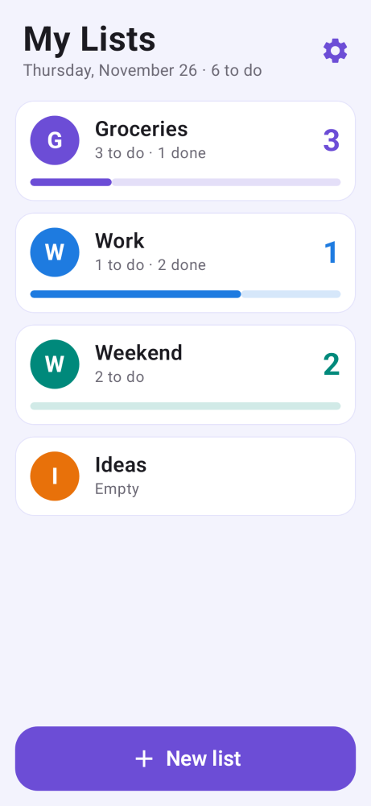
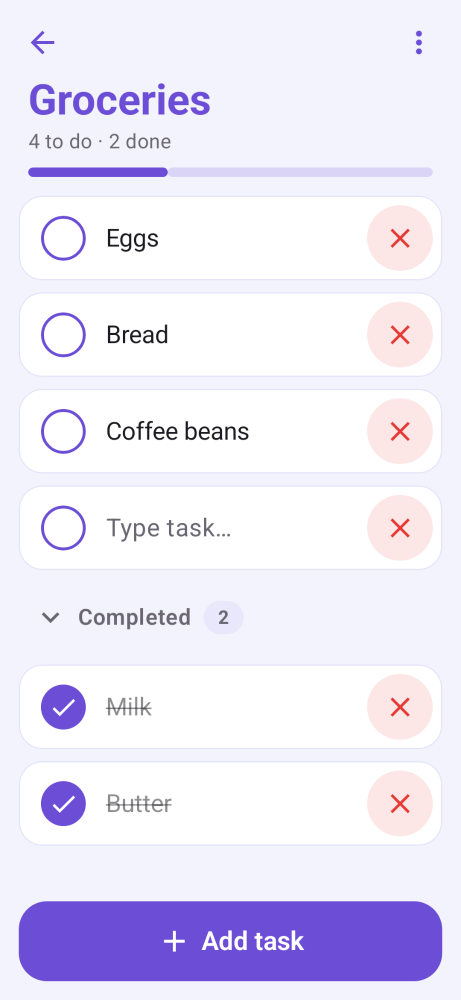
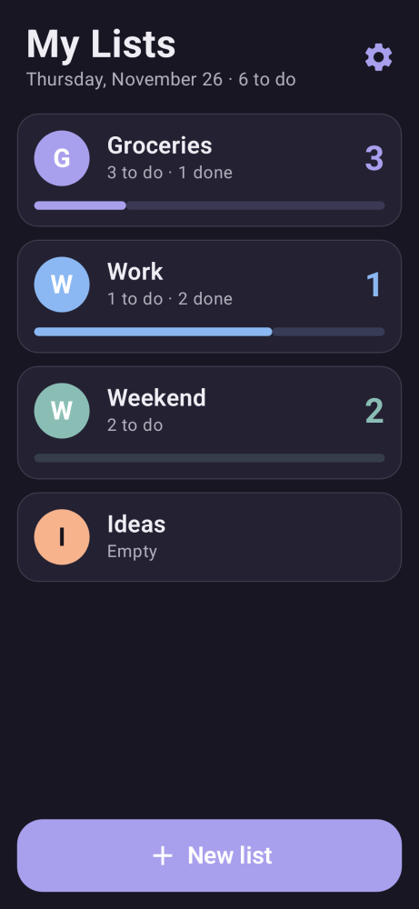
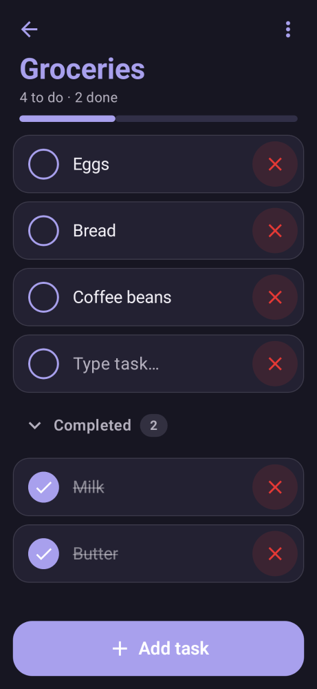
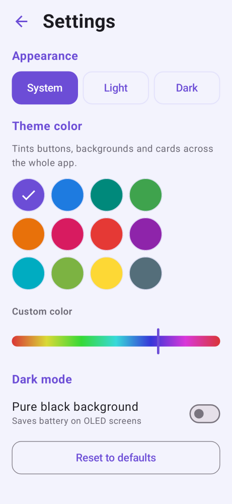
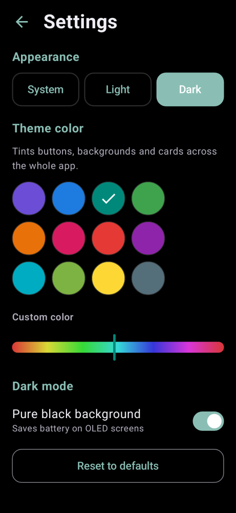
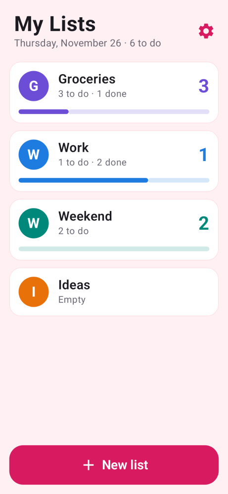

# Checklist

A simple Android checklist app built for big, easy taps.

- **Multiple colored lists** – a home screen of lists with progress bars (like Microsoft To Do); tap a list to open it, rename it by tapping its title, and pick its color (12 presets or any custom hue) from the ⋮ menu
- **Swipe gestures** – swipe a task **right** to mark it done (or not done), **left** to delete it; swipe a list left to delete it
- **Completed tasks** – done tasks move into a collapsible "Completed" section with a count you can show or hide
- **Large buttons** – 64dp check and delete buttons, a 72dp "Add" button
- **Enter opens the next box** – press Enter after typing a task and a new one opens below it, ready to type
- **Instant delete** – the red ✕ (or a left swipe) removes it right away, no "are you sure?" popup
- **Custom themes** – Settings (⚙ on the home screen) lets you choose System / Light / Dark, a theme color that tints the whole app, and a pure-black dark mode
- Everything is saved automatically

| | Lists | A list (completed shown) |
|---|---|---|
| Light |  |  |
| Dark |  |  |

### Settings and themes

| Settings (light) | Settings (dark, teal, pure black) | Pink theme |
|---|---|---|
|  |  |  |

## Build and test

```
./gradlew assembleDebug          # APK in app/build/outputs/apk/debug/
./gradlew testDebugUnitTest      # unit tests + screenshot rendering
./gradlew recordPaparazziDebug   # regenerate the README screenshots
./gradlew connectedDebugAndroidTest  # UI tests (needs emulator/device)
```

Screenshots are rendered on the JVM with [Paparazzi](https://github.com/cashapp/paparazzi), so no emulator is needed. CI (GitHub Actions) runs the unit tests, builds the APK, and runs the UI tests on an emulator.
