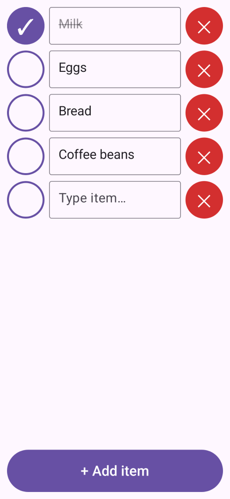
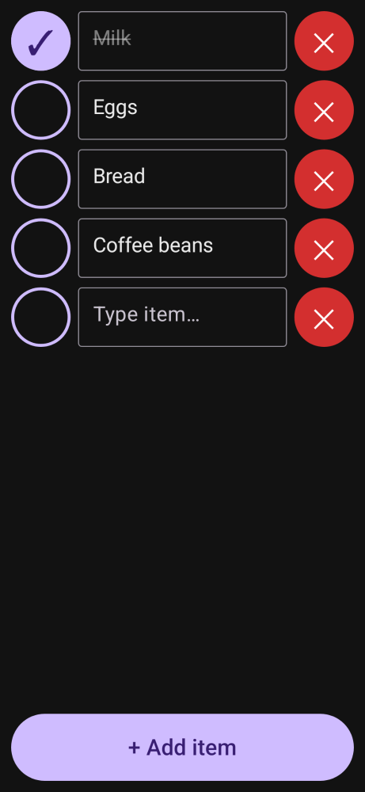

# Checklist

A simple Android checklist app built for big, easy taps.

- **Large buttons** – 64dp check and delete buttons, a 72dp "Add item" button
- **Enter opens the next box** – press Enter after typing an item and a new item opens below it, ready to type
- **Instant delete** – the red ✕ removes an item right away, no "are you sure?" popup
- **Light and dark mode** – follows the system setting
- Your list is saved automatically

| Light | Dark |
|-------|------|
|  |  |

## Build and test

```
./gradlew assembleDebug          # APK in app/build/outputs/apk/debug/
./gradlew testDebugUnitTest      # unit tests + screenshot rendering
./gradlew recordPaparazziDebug   # regenerate the README screenshots
./gradlew connectedDebugAndroidTest  # UI tests (needs emulator/device)
```

Screenshots are rendered on the JVM with [Paparazzi](https://github.com/cashapp/paparazzi), so no emulator is needed. CI (GitHub Actions) runs the unit tests, builds the APK, and runs the UI tests on an emulator.
